
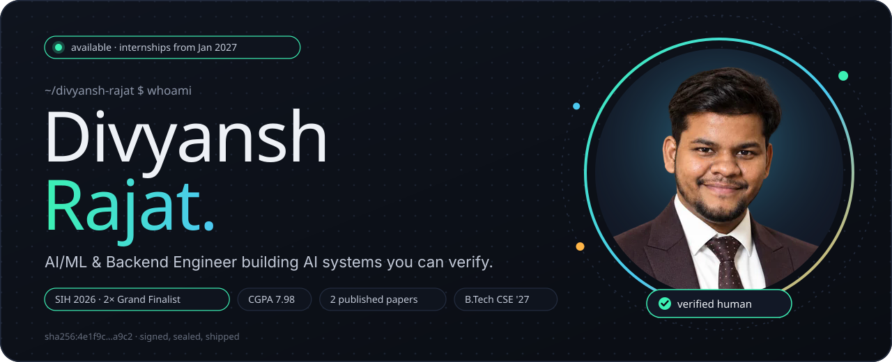

   

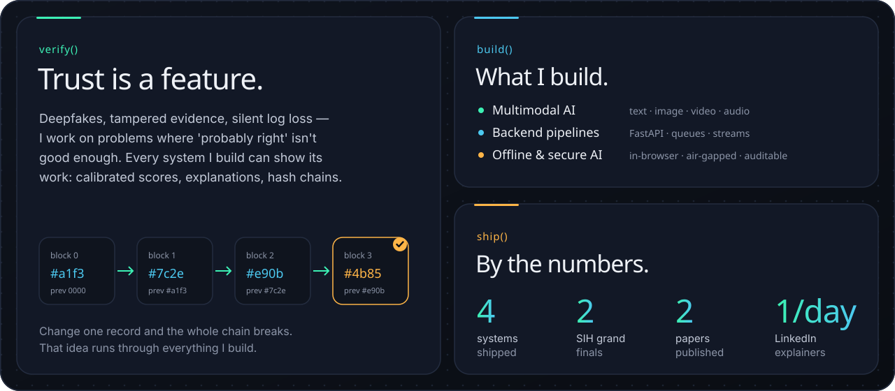

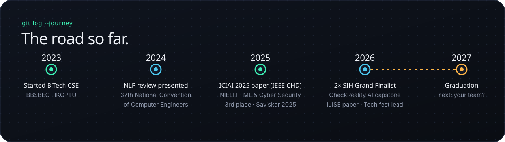

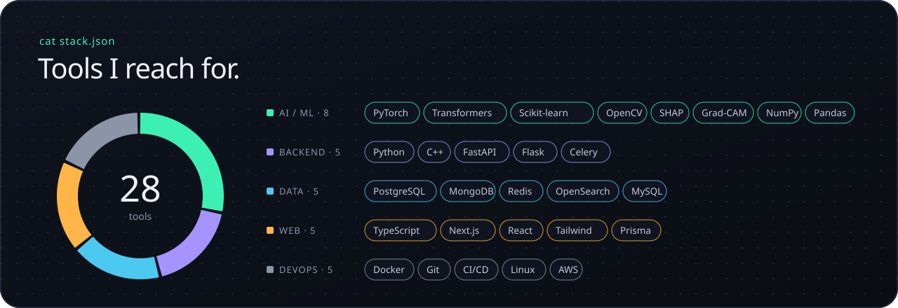

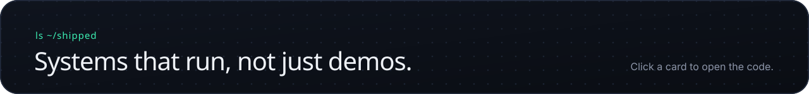

<a href="https://github.com/divyanshrajat/CheckRealityAI">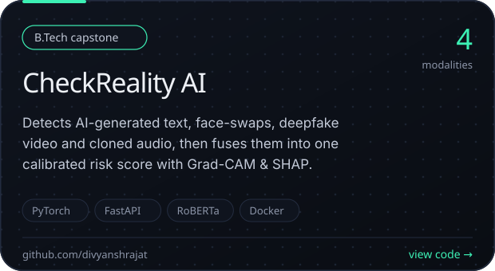</a>
<a href="https://github.com/divyanshrajat/ULPF">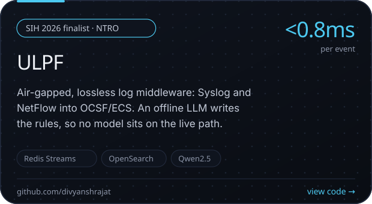</a>
<a href="https://github.com/divyanshrajat/NyayaVault">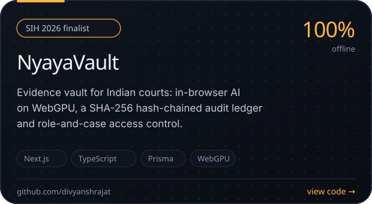</a>
<a href="https://github.com/divyanshrajat/AI_Plagiarism_Detection_System">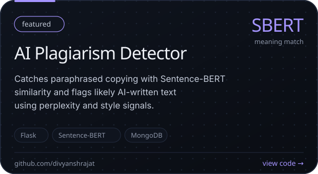</a>

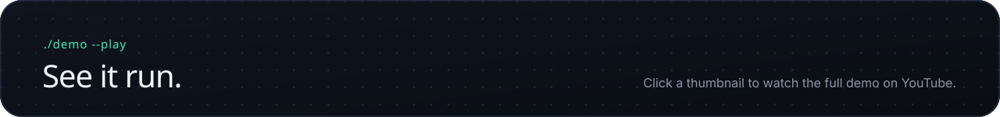

 
<a href="https://youtu.be/CtP4qNWQWBU">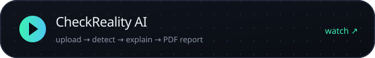</a>
<a href="https://youtu.be/D75t5Tz5PS0">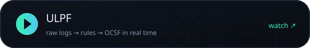</a>

 
<a href="https://youtu.be/5C_TEwFJf4Y">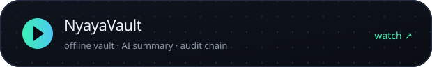</a>
<a href="https://youtu.be/QRrKFV5rzgk">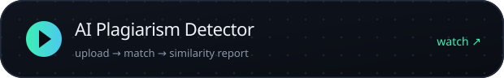</a>

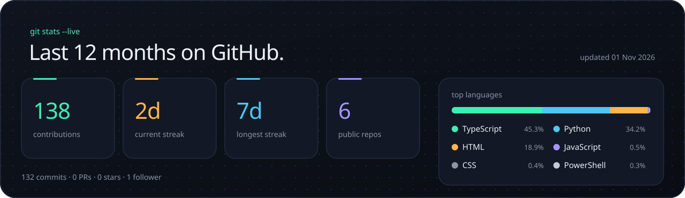

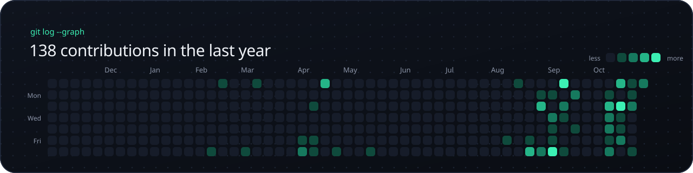

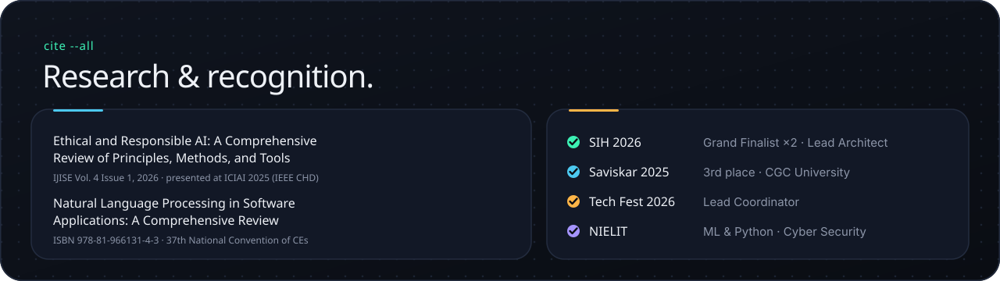

