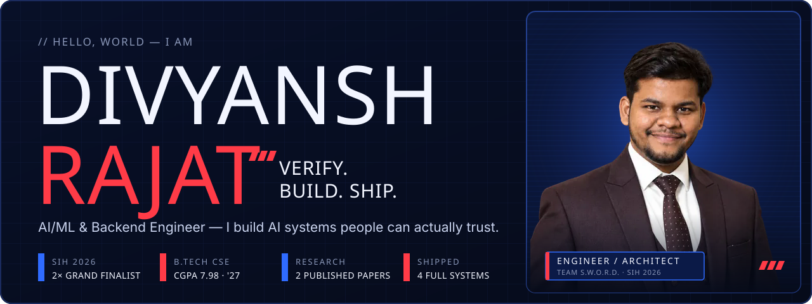
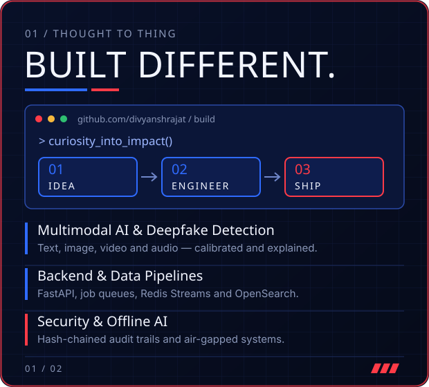
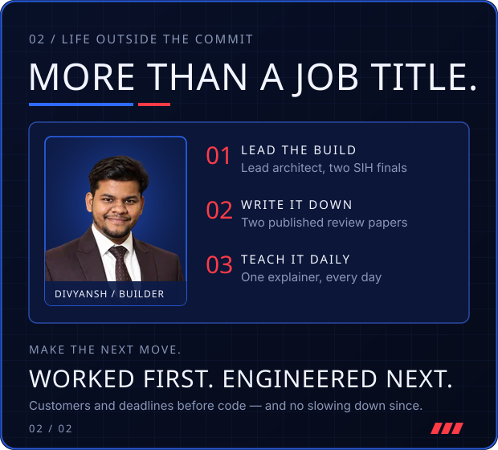
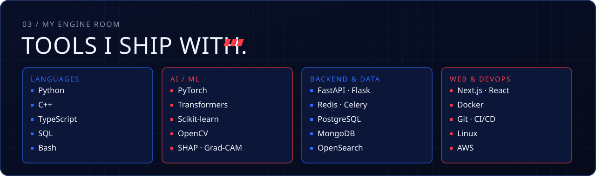
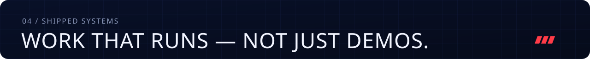
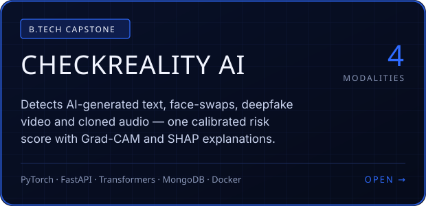
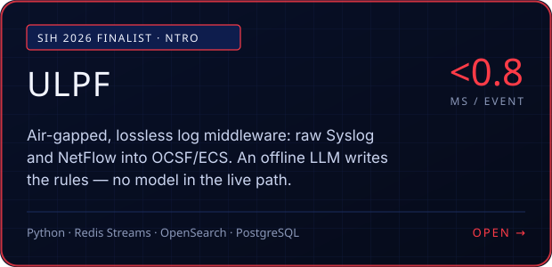
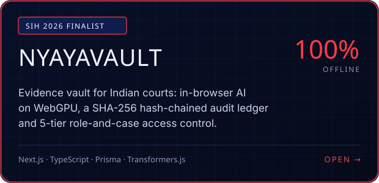
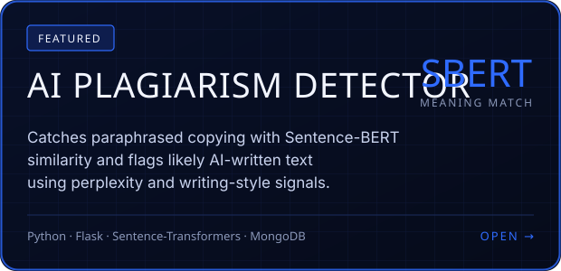

  

  
  
  
  

  
  

  

  

  
  
  
  

  ▶ Demos: <a href="https://youtu.be/CtP4qNWQWBU">CheckReality AI</a> · <a href="https://youtu.be/D75t5Tz5PS0">ULPF</a> · <a href="https://youtu.be/5C_TEwFJf4Y">NyayaVault</a> · <a href="https://youtu.be/QRrKFV5rzgk">AI Plagiarism Detector</a>

  

<b>📄 Research &amp; highlights</b>

 

**Research**
- **Ethical and Responsible AI: A Comprehensive Review of Principles, Methods, and Tools** — *International Journal of Information Security Engineering (IJISE)*, Vol. 4, Issue 1, 2026. Presented at ICIAI 2025 (IEEE Chandigarh Section).
- **Natural Language Processing in Software Applications: A Comprehensive Review** — ISBN 978-81-966131-4-3. Presented at the 37th National Convention of Computer Engineers.

**Highlights**
- 🥇 Smart India Hackathon 2026 — Grand Finalist on two problem statements (SIH26156 · SIH26190), Lead Architect, Team S.W.O.R.D.
- 🥉 3rd place, Saviskar 2025 (CGC University, Mohali)
- 🎤 Lead Coordinator, College Tech Fest 2026
- 📜 NIELIT certifications: Machine Learning & Python · Cyber Security
- 🎓 B.Tech CSE, BBSBEC (I. K. Gujral Punjab Technical University) · CGPA 7.98 · Class of 2027

  

