
<picture><source media="(prefers-color-scheme: dark)" srcset="assets/dark/hero.svg">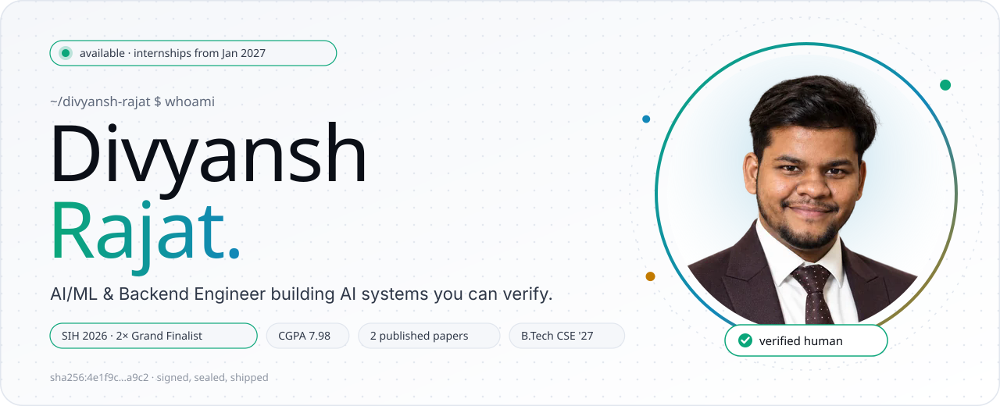</picture>

   

<picture><source media="(prefers-color-scheme: dark)" srcset="assets/dark/about.svg">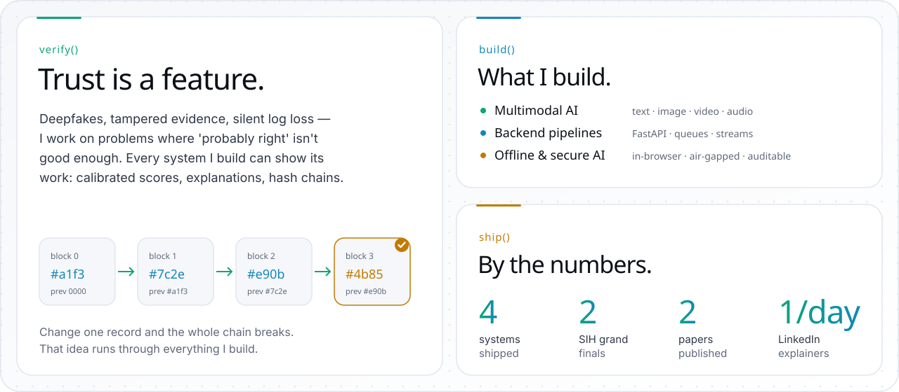</picture>

<picture><source media="(prefers-color-scheme: dark)" srcset="assets/dark/journey.svg">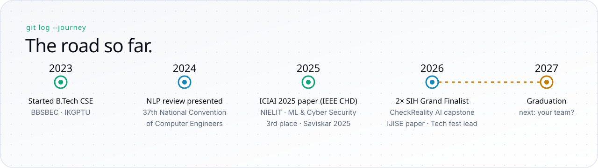</picture>

<picture><source media="(prefers-color-scheme: dark)" srcset="assets/dark/stack.svg">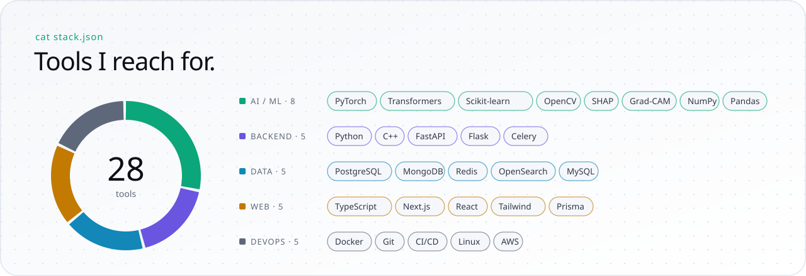</picture>

<picture><source media="(prefers-color-scheme: dark)" srcset="assets/dark/h-shipped.svg">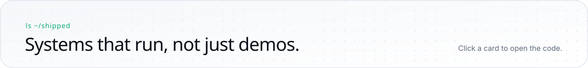</picture>

<a href="https://github.com/divyanshrajat/CheckRealityAI"><picture><source media="(prefers-color-scheme: dark)" srcset="assets/dark/p-checkreality.svg">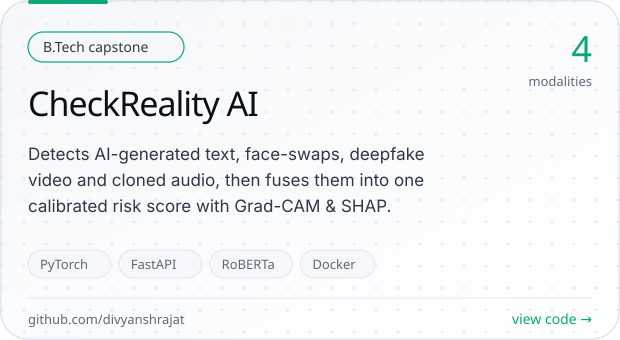</picture></a>
<a href="https://github.com/divyanshrajat/ULPF"><picture><source media="(prefers-color-scheme: dark)" srcset="assets/dark/p-ulpf.svg">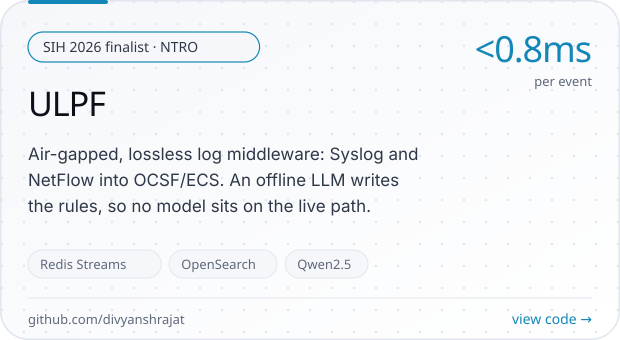</picture></a>
<a href="https://github.com/divyanshrajat/NyayaVault"><picture><source media="(prefers-color-scheme: dark)" srcset="assets/dark/p-nyayavault.svg">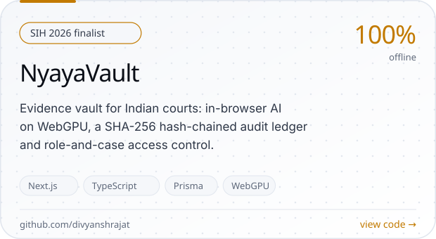</picture></a>
<a href="https://github.com/divyanshrajat/AI_Plagiarism_Detection_System"><picture><source media="(prefers-color-scheme: dark)" srcset="assets/dark/p-plagiarism.svg">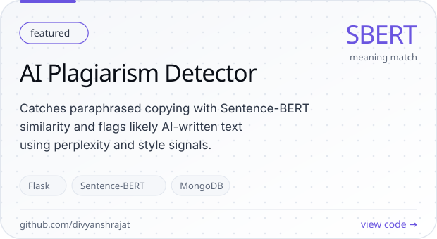</picture></a>

<picture><source media="(prefers-color-scheme: dark)" srcset="assets/dark/h-demos.svg"></picture>

 
<a href="https://youtu.be/CtP4qNWQWBU"><picture><source media="(prefers-color-scheme: dark)" srcset="assets/dark/d-checkreality.svg"></picture></a>
<a href="https://youtu.be/D75t5Tz5PS0"><picture><source media="(prefers-color-scheme: dark)" srcset="assets/dark/d-ulpf.svg"></picture></a>

 
<a href="https://youtu.be/5C_TEwFJf4Y"><picture><source media="(prefers-color-scheme: dark)" srcset="assets/dark/d-nyayavault.svg"></picture></a>
<a href="https://youtu.be/QRrKFV5rzgk"><picture><source media="(prefers-color-scheme: dark)" srcset="assets/dark/d-plagiarism.svg"></picture></a>

<picture><source media="(prefers-color-scheme: dark)" srcset="assets/dark/stats.svg">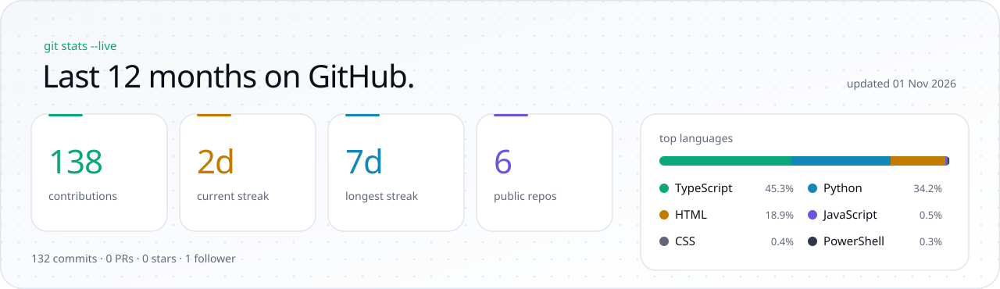</picture>

<picture><source media="(prefers-color-scheme: dark)" srcset="assets/dark/activity.svg">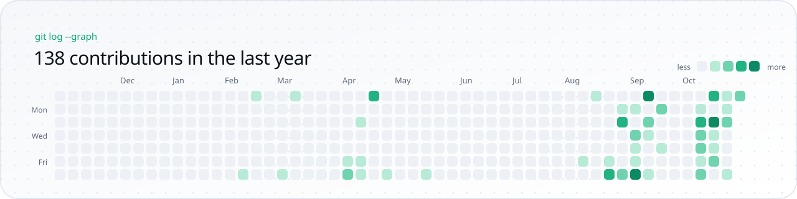</picture>

<picture><source media="(prefers-color-scheme: dark)" srcset="assets/dark/research.svg">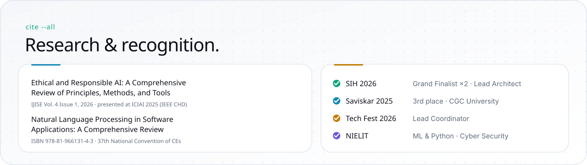</picture>

<picture><source media="(prefers-color-scheme: dark)" srcset="assets/dark/footer.svg"></picture>

