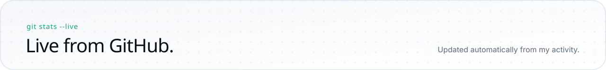

<picture><source media="(prefers-color-scheme: dark)" srcset="assets/dark/hero.svg"></picture>

   

<picture><source media="(prefers-color-scheme: dark)" srcset="assets/dark/about.svg"></picture>

<picture><source media="(prefers-color-scheme: dark)" srcset="assets/dark/journey.svg"></picture>

<picture><source media="(prefers-color-scheme: dark)" srcset="assets/dark/stack.svg"></picture>

<picture><source media="(prefers-color-scheme: dark)" srcset="assets/dark/h-shipped.svg"></picture>

<a href="https://github.com/divyanshrajat/CheckRealityAI"><picture><source media="(prefers-color-scheme: dark)" srcset="assets/dark/p-checkreality.svg"></picture></a>
<a href="https://github.com/divyanshrajat/ULPF"><picture><source media="(prefers-color-scheme: dark)" srcset="assets/dark/p-ulpf.svg"></picture></a>
<a href="https://github.com/divyanshrajat/NyayaVault"><picture><source media="(prefers-color-scheme: dark)" srcset="assets/dark/p-nyayavault.svg"></picture></a>
<a href="https://github.com/divyanshrajat/AI_Plagiarism_Detection_System"><picture><source media="(prefers-color-scheme: dark)" srcset="assets/dark/p-plagiarism.svg"></picture></a>

<picture><source media="(prefers-color-scheme: dark)" srcset="assets/dark/h-demos.svg"></picture>

 
<a href="https://youtu.be/CtP4qNWQWBU"><picture><source media="(prefers-color-scheme: dark)" srcset="assets/dark/d-checkreality.svg"></picture></a>
<a href="https://youtu.be/D75t5Tz5PS0"><picture><source media="(prefers-color-scheme: dark)" srcset="assets/dark/d-ulpf.svg"></picture></a>

 
<a href="https://youtu.be/5C_TEwFJf4Y"><picture><source media="(prefers-color-scheme: dark)" srcset="assets/dark/d-nyayavault.svg"></picture></a>
<a href="https://youtu.be/QRrKFV5rzgk"><picture><source media="(prefers-color-scheme: dark)" srcset="assets/dark/d-plagiarism.svg"></picture></a>

<picture><source media="(prefers-color-scheme: dark)" srcset="assets/dark/h-stats.svg"></picture>

<picture><source media="(prefers-color-scheme: dark)" srcset="https://github-readme-stats.vercel.app/api?username=divyanshrajat&show_icons=true&include_all_commits=true&count_private=true&border_radius=18&hide_title=false&bg_color=0F141E&title_color=3CF0B4&text_color=C3CAD8&icon_color=4CC9F0&border_color=232C3F"></picture>
<picture><source media="(prefers-color-scheme: dark)" srcset="https://github-readme-stats.vercel.app/api/top-langs/?username=divyanshrajat&layout=compact&langs_count=8&border_radius=18&bg_color=0F141E&title_color=3CF0B4&text_color=C3CAD8&icon_color=4CC9F0&border_color=232C3F"></picture>

<picture><source media="(prefers-color-scheme: dark)" srcset="https://streak-stats.demolab.com/?user=divyanshrajat&border_radius=18&background=0F141E&ring=3CF0B4&fire=FFB547&currStreakNum=EEF1F6&currStreakLabel=3CF0B4&sideNums=EEF1F6&sideLabels=8C95A8&dates=8C95A8&stroke=232C3F&border=232C3F"></picture>

<picture><source media="(prefers-color-scheme: dark)" srcset="https://github-readme-activity-graph.vercel.app/graph?username=divyanshrajat&area=true&hide_border=false&radius=18&custom_title=Contribution%20activity&bg_color=0F141E&color=C3CAD8&title_color=EEF1F6&line=3CF0B4&point=FFB547&area_color=3CF0B4&border_color=232C3F"></picture>

<picture><source media="(prefers-color-scheme: dark)" srcset="assets/dark/research.svg"></picture>

<picture><source media="(prefers-color-scheme: dark)" srcset="assets/dark/footer.svg"></picture>

