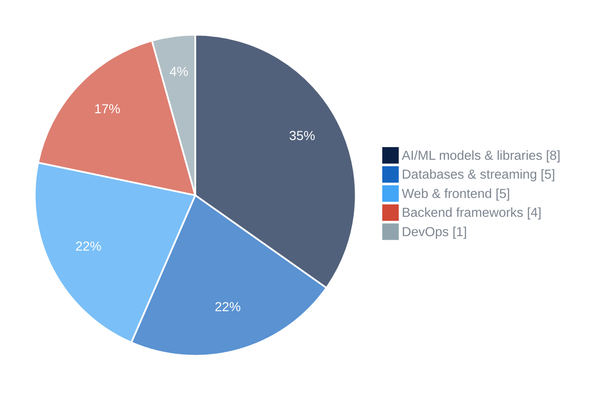
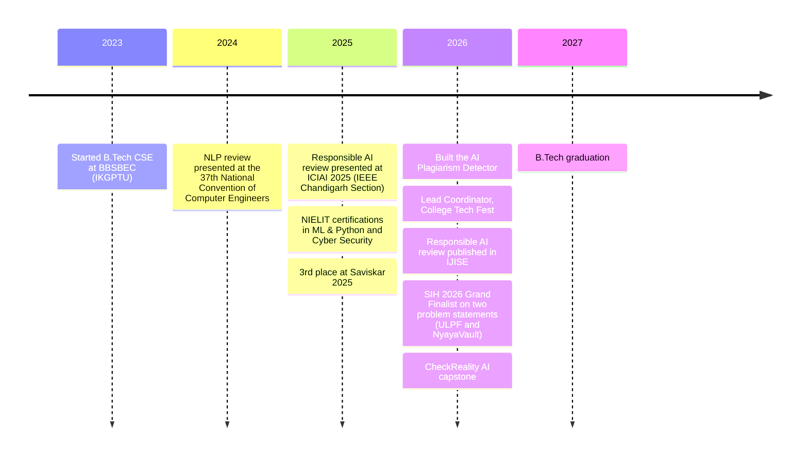

<h1 align="center">Hi, I'm Divyansh Rajat 👋</h1>

<b>AI/ML & Backend Developer · B.Tech CSE '27 · Smart India Hackathon 2026 Finalist ×2</b>

I build AI systems that have to work outside the notebook: offline, under tight latency budgets, and with an audit trail people can trust.

  
  
  
  

---

### 🔭 About me

- 🎓 Final-year B.Tech Computer Science at **BBSBEC** (I. K. Gujral Punjab Technical University), CGPA 7.98
- 🏆 **Lead Architect, Team S.W.O.R.D.**: two problem statements in the Smart India Hackathon 2026 Grand Finale
- 🧠 Working on multimodal deepfake detection, offline/in-browser AI, and high-throughput backend pipelines
- 📄 Two published reviews: Responsible AI (IJISE 2026) and NLP in Software Applications
- 🎯 Open to **AI/ML and backend engineering internships** for 2026–27

---

### 🚀 Featured projects

| Project | What it does | Stack | Links |
|---|---|---|---|
| **[CheckReality AI](https://github.com/divyanshrajat/CheckRealityAI)** B.Tech capstone | Detects AI-generated text, face-swaps, deepfake video and cloned audio, then fuses them into one calibrated risk score with Grad-CAM/SHAP explanations and audit reports | PyTorch · FastAPI · Transformers · OpenCV · MongoDB · Docker | [Demo](https://youtu.be/CtP4qNWQWBU) |
| **[ULPF](https://github.com/divyanshrajat/ULPF)** SIH 2026 Finalist · NTRO | Air-gapped, lossless log middleware: raw Syslog/NetFlow → OCSF/ECS with a sub-0.8 ms parsing hot path. An offline LLM writes the parsing rules, so no model sits in the latency path | Python · FastAPI · Redis Streams · OpenSearch · PostgreSQL · Qwen2.5-Coder | [Demo](https://youtu.be/D75t5Tz5PS0) |
| **[NyayaVault](https://github.com/divyanshrajat/NyayaVault)** SIH 2026 Finalist | 100% offline evidence vault for Indian courts: in-browser NLP via WebGPU/WASM, SHA-256 hash-chain ledger, Section 63 BNSS reports, 5-tier access control | Next.js · TypeScript · Prisma · Transformers.js · Tesseract.js | [Demo](https://youtu.be/5C_TEwFJf4Y) |
| **[AI Plagiarism Detector](https://github.com/divyanshrajat/AI_Plagiarism_Detection_System)** | Catches paraphrased plagiarism with Sentence-BERT similarity and flags AI-written text using perplexity and stylometry | Python · Flask · NLTK · Sentence-Transformers · MongoDB | [Demo](https://youtu.be/QRrKFV5rzgk) |

---

### 🛠️ Tech stack

**Languages** 

**AI / ML** 

**Backend & data** 

**Web & DevOps** 

---

### 📊 Stats & insights

  

**Technology mix across featured projects** · number of tools used across CheckReality AI, ULPF, NyayaVault and the AI Plagiarism Detector

**Journey so far**

---

### 📄 Research

- **Ethical and Responsible AI: A Comprehensive Review of Principles, Methods, and Tools**: *International Journal of Information Security Engineering (IJISE)*, Vol. 4, Issue 1, 2026. Presented at ICIAI 2025 (IEEE Chandigarh Section).
- **Natural Language Processing in Software Applications: A Comprehensive Review**: ISBN 978-81-966131-4-3. Presented at the 37th National Convention of Computer Engineers.

---

### 🏅 Highlights

- 🥇 Smart India Hackathon 2026: Grand Finalist on two problem statements (SIH26156 · SIH26190)
- 🥉 3rd place, Saviskar 2025 (CGC University, Mohali)
- 🎤 Lead Coordinator, College Tech Fest 2026
- 📜 NIELIT certifications: Machine Learning & Python · Cyber Security

---

<i>"Simplicity is prerequisite for reliability." – Edsger W. Dijkstra</i>

